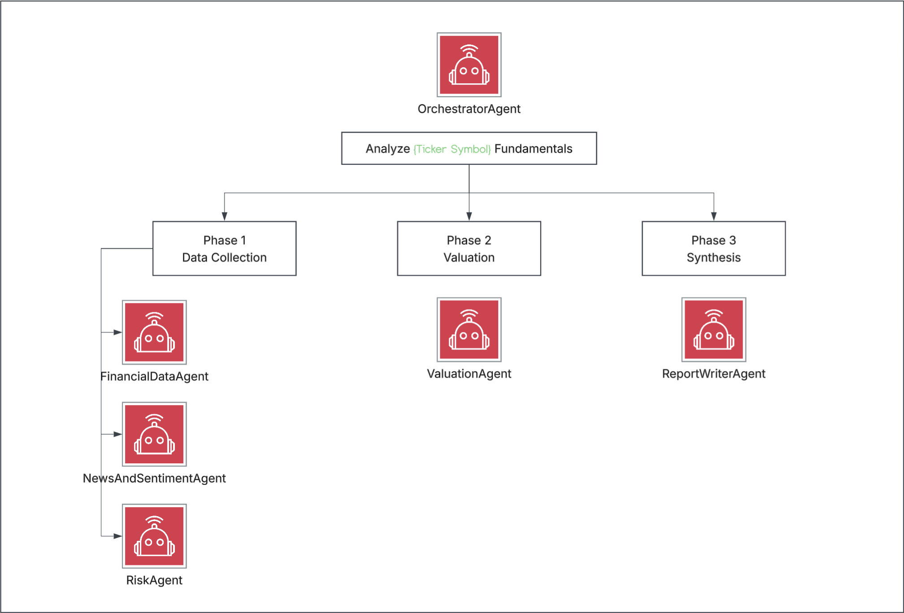

# Purpose: 
> An AI-powered fundamental stock analysis pipeline built with the OpenAI Agents SDK. Five specialist agents (financial data, valuation, news/sentiment, risk, report writer) collaborate under an Orchestrator to produce a professional investment brief for any publicly traded stock.

--------

# Fundamental Analysis
> Fundamental analysis consists of determing a company's intrinsic value, meaning what the business is actually worth, independent of what the stock price. This contrasts to technical analysis which focuses on predicting the future price movements by analyzing historical price charst and trading volume. 

## Two complimentary pillars of Fundamentals Analysis 
1. `Quantitiative Analysis`: A focus on the numbers. Three (3) financial statements form this foundation: 1. `income statement`, 2. `balance sheet`, & 3. `cash flow`. The output of the analysis is a review of ratios that provide insight into profitability, financial strength, efficiency, and valuation. 

2. `Qualitative Analysis`: A focus on the narrative. These tend to evaluate competitive advantage, management allocation of capital, industry trends. The output of this analysis is signals are extracted from earnings, mgmt interviews, industry reports, news, etc. 

## Intended Outcome 
Every public company produces three (3) core financial statements on a regular basis. This solution will establish agents, a workflow, specific criteria, and a synthesis of these 3 core documents: 

1. `income statement`: evaluating specifically: 
    - Revenue, 
    - Gross Profit, 
    - Operating Income, 
    - Net Income

2. `balance sheet`:  evaluating specifically:
    - Cash and Equivalents 
    - Total Debt & 
    - Shareholder's Equity

3. `cash flow statement`: evaluating specifically 
    - Operating Cash Flow, 
    - Capital Expenditures & 
    - Free Cash Flow 

Key Ratios that these documents and metrics will be contribute to are: 

1. `Valuation Ratios`: specifcally: 
    - Price to Earnings (P/E) ratio 
    - Price to Book (P/B) ratio 
    - Price to Sales (P/S) ratio, 
    - Enterprise Value to Earnings Before Interest, Taxes, Depreciation (EV/EBITDA) & 
    - Enterprise Value to Revenue (EV/R) ratio

2. `Profitability Ratios`: specifically: 
    - Gross Margin, 
    - Operating Margin, 
    - Net Margin, 
    - Return on Equity (ROE), & 
    - Return on Assets (ROA) 

3. `Liquiditity and Leverage Ratios`: specically: 
    - Current Ratio, 
    - Quick Ratio, & 
    - Debt-to-equity-ratio (Debt/equity)

4. `Growth Metrics` ratios: specifically 
    - Revenue growth (YoY), 
    - Revenue Growth (3-year), 
    - Earnings Growth (YoY), & 
    - Earnings Growth (Qtrly)

5. `Dividend ratios`: specifcally 
    - Dividend yield, 
    - Payout ratio, & 
    - Annual Dividend rate

--------

# Architecture 

## Design Considerations 

The fundamental analysis workflow is inherently multi-step. To design the right architecture for this type of process, the key question to ask is *NOT* which model to use, but *HOW TO DECOMPOSE* the problem into the appropriate agents & tools, each addressing a specific objective at the right stage of the workflow. 

This leads the first consideration to `Single Agent vs. Multi Agent` in the design. This will contribute to: 
- Context Window pollution
- Instruction clarity
- Parallelism
- Testability and Debugging
- Separation of Concerns

## The Agentic System Architecture
Our fundamental analysis system is built as a multi-agent pipeline composed of five specialized agents, coordinated by an orchestrator agent. Each agent is designed with a clear responsibility and operates on a well-defined subset of the problem, ensuring modularity, traceabilty, and reliability. 

Since we know this will now be a multi-agent system, we can use an `orchestrator pattern` to manage the agents and workflow. At the core of the system, we separate concerns across three dimensions: 

### 1. Data Collection
The orchestrator runs three agents in parallel: the `FinancialDataAgent`, `NewsAndSentimentAgent`, & `RiskAgent`. These agents operate independently, each gathering and analyzing different types of information. Running them in parallel improves efficiency while preserving clear separation of concerns. 

### 2. Valuation
The orchestrator triggers the `ValuationAgent`. This phase depends on the outputs of the `FinancialDataAgent`, as valuation models require financial inputs. The agent computes intrinsic value estimates and produces a valuation verdict. 

### 3. Synthesis
The orchestrator invokes the `ReportWriterAgent`. At this stage, all intermediate analysis are available. The agent aggregates financial insights, valuation results, sentiment analysis, and risk assessments into a single, coherent investment report. 

    

----------

