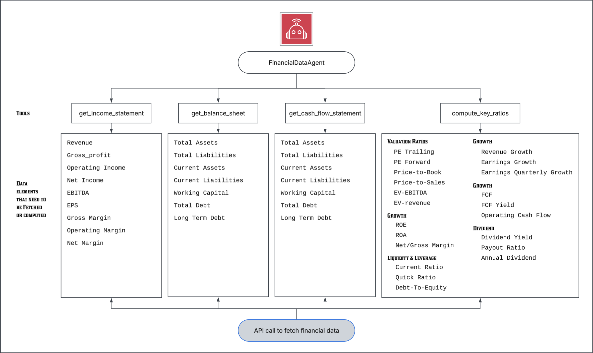

# Purpose
> An AI-powered fundamental stock analysis pipeline built with the OpenAI Agents SDK. Five specialist agents (financial data, valuation, news/sentiment, risk, report writer) collaborate under an Orchestrator to produce a professional investment brief for any publicly traded stock.

--------

# Fundamental Analysis
> Fundamental analysis consists of determing a company's intrinsic value, meaning what the business is actually worth, independent of what the stock price. This contrasts to technical analysis which focuses on predicting the future price movements by analyzing historical price charst and trading volume. 

## Two complimentary pillars of Fundamentals Analysis 
1. `Quantitiative Analysis`: A focus on the numbers. Three (3) financial statements form this foundation: 1. `income statement`, 2. `balance sheet`, & 3. `cash flow`. The output of the analysis is a review of ratios that provide insight into profitability, financial strength, efficiency, and valuation. 

2. `Qualitative Analysis`: A focus on the narrative. These tend to evaluate competitive advantage, management allocation of capital, industry trends. The output of this analysis is signals are extracted from earnings, mgmt interviews, industry reports, news, etc. 

## Intended Outcome 
Every public company produces three (3) core financial statements on a regular basis. This solution will establish agents, a workflow, specific criteria, and a synthesis of these 3 core documents: 

1. `income statement`: evaluating specifically: 
    - Revenue, 
    - Gross Profit, 
    - Operating Income, 
    - Net Income

2. `balance sheet`:  evaluating specifically:
    - Cash and Equivalents 
    - Total Debt & 
    - Shareholder's Equity

3. `cash flow statement`: evaluating specifically 
    - Operating Cash Flow, 
    - Capital Expenditures & 
    - Free Cash Flow 

Key Ratios that these documents and metrics will be contribute to are: 

1. `Valuation Ratios`: specifcally: 
    - Price to Earnings (P/E) ratio 
    - Price to Book (P/B) ratio 
    - Price to Sales (P/S) ratio, 
    - Enterprise Value to Earnings Before Interest, Taxes, Depreciation (EV/EBITDA) & 
    - Enterprise Value to Revenue (EV/R) ratio

2. `Profitability Ratios`: specifically: 
    - Gross Margin, 
    - Operating Margin, 
    - Net Margin, 
    - Return on Equity (ROE), & 
    - Return on Assets (ROA) 

3. `Liquiditity and Leverage Ratios`: specically: 
    - Current Ratio, 
    - Quick Ratio, & 
    - Debt-to-equity-ratio (Debt/equity)

4. `Growth Metrics` ratios: specifically 
    - Revenue growth (YoY), 
    - Revenue Growth (3-year), 
    - Earnings Growth (YoY), & 
    - Earnings Growth (Qtrly)

5. `Dividend ratios`: specifcally 
    - Dividend yield, 
    - Payout ratio, & 
    - Annual Dividend rate

--------

# Architecture 

## Design Considerations 

The fundamental analysis workflow is inherently multi-step. To design the right architecture for this type of process, the key question to ask is *NOT* which model to use, but *HOW TO DECOMPOSE* the problem into the appropriate agents & tools, each addressing a specific objective at the right stage of the workflow. 

This leads the first consideration to `Single Agent vs. Multi Agent` in the design. This will contribute to: 
- Context Window pollution
- Instruction clarity
- Parallelism
- Testability and Debugging
- Separation of Concerns

## The Agentic System Architecture
Our fundamental analysis system is built as a multi-agent pipeline composed of five specialized agents, coordinated by an orchestrator agent. Each agent is designed with a clear responsibility and operates on a well-defined subset of the problem, ensuring modularity, traceabilty, and reliability. 

Since we know this will now be a multi-agent system, we can use an `orchestrator pattern` to manage the agents and workflow. At the core of the system, we separate concerns across three dimensions: 

#### 1. Data Collection
The orchestrator runs three agents in parallel: the `FinancialDataAgent`, `NewsAndSentimentAgent`, & `RiskAgent`. These agents operate independently, each gathering and analyzing different types of information. Running them in parallel improves efficiency while preserving clear separation of concerns. 

#### 2. Valuation
The orchestrator triggers the `ValuationAgent`. This phase depends on the outputs of the `FinancialDataAgent`, as valuation models require financial inputs. The agent computes intrinsic value estimates and produces a valuation verdict. 

#### 3. Synthesis
The orchestrator invokes the `ReportWriterAgent`. At this stage, all intermediate analysis are available. The agent aggregates financial insights, valuation results, sentiment analysis, and risk assessments into a single, coherent investment report. 

<p align=center >
    
</p>

----------

# Development

## Building the `FinancialDataAgent`

The `FinancialDataAgent` acts as a specialized data analysis component responsible for retrieving and interpreting a company's financial statements. Given a stock ticker, the `FinancialDataAgent` systematically invokes dedicated tools to collect the income statement, balance sheet, cash flow statement, and key financial ratios. 

Based on these inputs, the agent produces a structured and data-driven analysis coverting revenue and profitability trends, balance sheet health, cash-flow quality, and a snapshot of key ratios. 

The agent is constrained to generate explanations strictly grounded in the retrieved data, ensuring that every statement is traceable to a specific numerical value. 

This agent is the data foundation of the entire pipeline.

<p align=center >
    
</p>


There will be 3 code components found in the directory structure that that make up the `FinancialDataAgent`. 
1. Foundational code for the development *Environment* | framework | directory structure to work. This includes utilities, libraries, folder structure, imports, and `main.py`.
2. Code that creates the *Agent*, found in `specialist_agents/financial_analyst_agent.py`. 
3. Code that provides the *Tools* the agent uses, found in `tools/financial_tools.py`

This segmentation and directory of the 1. *Framework*, 2. *Agents* build and the 3. *Tooling* will continue to preserve the seperation of concerns and allow the application to 1. maintainable and 2. scalable going forward. 

> NOTE: The most signficiant environment build out will come in the first development actions, it is not specific to the FinancialDataAgent. Had we started with a different Agent first, we would have listed these steps along that Agent. Environment componets are modified throughout the lifecycle of a development, so even if no changes are needed for subsequent agents, other parts of the build may need environment configuration. 

### Environment Setup

1. Change to the root directory

```sh
cd fundamentals-analysis-agent
```

2. Create the virtual environment
```sh
python3 -m venv .venv
source .venv/bin/activate
```

3. Install the dependencies 
```sh
pip install -r requirements.txt
```

4. Copy your OpenAPI key. Copy .env.example to .env and add your key: 
```sh
cp .env.example .env
```

5. Ensure that you have an OpenAPI key from this site: [OpenAI](https://platform.openai.com/api-keys), and paste into the `.env.example` file. Replace the `sk-your-openai-api-key-here` with your actual key.

```python
OPENAI_API_KEY=sk-your-openai-api-key-here
```

6. Create a file called `main.py` and input the following code, this will verify that you set up your OpenAI API key correctly. 

```python
import sys

from dotenv import load_dotenv
from openai import APIConnectionError, APIStatusError, AuthenticationError, OpenAI


PLACEHOLDER_VALUES = {
    "",
    "sk-your-openai-api-key-here",
}

def main() -> int:
    load_dotenv()

    client = OpenAI()
    key = client.api_key or ""

    if key.strip() in PLACEHOLDER_VALUES:
        print("OPENAI_API_KEY is missing. Copy .env.example to .env and set a real key.")
        return 1

    try:
        page = client.models.list()
        model_ids = [model.id for model in page.data]
    except AuthenticationError:
        print("OPENAI_API_KEY was rejected (401). Check the key on platform.openai.com.")
        return 1
    except APIConnectionError as exc:
        print(f"Could not reach the OpenAI API: {exc}")
        return 1
    except APIStatusError as exc:
        print(f"OpenAI API returned status {exc.status_code}: {exc.message}")
        return 1

    preview = f"{key[:7]}...{key[-4:]}" if len(key) > 12 else "(set)"
    print(f"OPENAI_API_KEY is valid ({preview}).")
    print(f"Account can list {len(model_ids)} models.")
    return 0


if __name__ == "__main__":
    sys.exit(main())
```

> NOTE: The only thing this code does is check to see if your OpenAI key is valid, it does not yet invoke our FinancialDataAgent. That will come later. 

7. Create a `.gitignore` file so you .env file and the OpenAI key does not get committed to `github`. Input the following code: 

```python
# Virtual environments
.venv/
venv/

# Environment / secrets
.env

# Logs and run artifacts
logs/
working_memory.txt
*.log
```

8. Create a `tools` and an `specialist_agents` directory so you can input the Agent build scripts and the Tool scripts in thier respective directories and can reference, scale, or troubleshoot them as needed later. 

```sh
# Be sure you are in the `fundamentals-analysis-agent` directory before running the next line
mkdir tools specialist_agents
```

----------

### Agent Setup

1. Start by defining the instructions of the agent which act as its *operating policy*. We will create a file in the `specialist_agents` directory called `financial_analyst_agent.py`. 

In that file, we will start by adding instructions to clearly specify the agent's role. This is similar to a prompt you may enter into a LLM session (e.g. Claude, Co-Pilot, Grok, etc). 

What you are doing is providing instructions that we will pass to the OpenAI LLM via API using a prompting technique called PCIF (Persona, Context, Instructions, & Format)[here](./reference/pcif.md).  Here we will consistently defining for the Agent we are about to create how to behave like a senior financial analyst specialized  in interpretting corporte financial statements. They also define the exact workflow the agent must follow by explicitly listing the tool calls in sequence and explaining the purpose of each one. 

```python
# file -> fundamentals-analysis-agent/specialist_agents/financial_analyst_agent.py

"""
financial_data_agent.py
-----------------------
Specialist agent for retrieving and interpreting financial statements.

This agent is the data foundation of the pipeline. It uses four tools to
fetch the income statement, balance sheet, cash flow statement, and a
computed set of key ratios. It returns structured, interpreted findings
that the Orchestrator and Valuation Agent will consume downstream.
"""

# PLACEHOLDER 1 IMPORTS: We will insert more code here to Import tools (see Tool Setup below)

FINANCIAL_DATA_INSTRUCTIONS = """
You are a senior financial analyst specializing in reading and interpreting
corporate financial statements.

Your job:
Given a stock ticker, retrieve the company's financial statements and compute
key fundamental ratios. Then provide a concise, structured interpretation.

Steps to follow:
1. Call get_income_statement(ticker) to fetch revenue, margins, and earnings.
2. Call get_balance_sheet(ticker) to fetch assets, liabilities, equity, and debt.
3. Call get_cash_flow_statement(ticker) to fetch operating, investing, and FCF.
4. Call compute_key_ratios(ticker) to get valuation, profitability, leverage, and growth ratios.

After gathering all data, write a structured summary with these sections:
- REVENUE & PROFITABILITY: Revenue trend (growing/declining), margin quality.
- BALANCE SHEET HEALTH: Debt levels, cash position, working capital.
- CASH FLOW QUALITY: Is FCF growing? Does it track net income (quality indicator)?
- KEY RATIOS SNAPSHOT: Highlight the 5-6 most important ratios for this company.
- FINANCIAL HEALTH VERDICT: One of [STRONG | SOLID | MIXED | WEAK] with 2-3 sentence justification.

STRICT RULES:
- Every statement must be directly supported by a number from the tool outputs.
  Do not add qualitative judgments or editorial conclusions that cannot be traced
  to a specific data point (e.g. do not say "enhances shareholder value",
  "reflects management discipline", or similar unsourced interpretations).
- Each section must be self-contained. Do not reference data that belongs to a
  later section (e.g. do not mention cash flows inside BALANCE SHEET HEALTH —
  cash flows are covered in CASH FLOW QUALITY).
- If a data point is unavailable, say so explicitly rather than omitting it silently.
"""

# PLACEHOLDER 2 Agent CREATE: We will insert more code here to create the Agent (see Agent Create below)

```

### Tool Setup

2. Agents use tools to execute the functions that we specify through code, these are *Tools* we provision the agent to execute a task. Sometimes these tools can be a request to an MCP service, and API, or functions that we write in code. 

The *Tools* that we require for our `FinancialDataAgent` are:
1. `get_income_statement` 
2. `get_balance_sheet` 
3. `get_cash_flow_statement` & 
4. `compute_key_ratios`

We will not write the logic for these tools directly in our `financial_analyst_agent.py` file, because tools are different than an Agent. We may add tools without ever modifying our Agent for example, so we want to keep a separation of concerns rule in our directory/file archtiecture. 

Therefore, in our `fundamentals-analysis-agent/tools` directory, we need to create another file called `financial_tools.py`. 

In this file input the following code: 

```python
"""
financial_tools.py
------------------
Tools for fetching and processing financial statements using yfinance.
All tools use the @function_tool decorator from the OpenAI Agents SDK.
"""

import json
import yfinance as yf
import pandas as pd
from agents import function_tool
from tools import cache as _cache

# ---------------------------------------------------------------------------
# Helper utilities
# ---------------------------------------------------------------------------

# ---------------------------------------------------------------------------
# Tool 1: Income Statement
# ---------------------------------------------------------------------------

# ---------------------------------------------------------------------------
# Tool 2: Balance Sheet
# ---------------------------------------------------------------------------

# ---------------------------------------------------------------------------
# Tool 3: Cash Flow Statement
# ---------------------------------------------------------------------------

# ---------------------------------------------------------------------------
# Tool 4: Key Ratios
# ---------------------------------------------------------------------------

```

Here you can see that we've once again allowed ourselves a method to import other helper utilities, libraries, and make reference to other files we will use. I've also used comments to draft psuedo-code areas of functionality/logic we will have to write to implement the logic we want to define for our Agent to execute. The file will get too large to write an explanation for all the code, so if you want to see the Python code that gets executed for each of these areas, review the file `fundamentals-analysis-agent/tools/financial_tools.py`. 

A small example would look like this: 

```python
# ---------------------------------------------------------------------------
# Helper utilities
# ---------------------------------------------------------------------------

def _safe_float(value) -> float | None:
    """Convert a value to float, returning None if not possible."""
    try:
        if value is None or (isinstance(value, float) and pd.isna(value)):
            return None
        return round(float(value), 2)
    except (TypeError, ValueError):
        return None


def _millions(value) -> float | None:
    """Convert a value to millions, rounded to 2 decimal places."""
    v = _safe_float(value)
    return round(v / 1_000_000, 2) if v is not None else None


def _extract_row(df: pd.DataFrame, *row_names: str, col) -> float | None:
    """Try multiple row name variants and return the first match."""
    for name in row_names:
        try:
            if name in df.index:
                return _millions(df.loc[name, col])
        except (KeyError, TypeError):
            continue
    return None
``` 

> Here you see Helper utilities that the Agent will use to do data formatting and extracting data from rows. Similar python logic is written for Tool 1: Income Statement, Tool 2: Balance Sheet, etc. 

3. These `tools` will need to be imported into our `financial_analyst_agent.py` file, which was the Placeholder 1 reference above. Go back to the `fundamentals-analysis-agent/financial_analyst_agent.py` file and insert the following code now that the `fundamentals-analysis-agent/financial_tools.py` file is creaetd. 

```python
# PLACEHOLDER 1 IMPORTS: We will insert more code here to Import tools (see Tool Setup below)
from agents import Agent
from tools.financial_tools import (
    get_income_statement,
    get_balance_sheet,
    get_cash_flow_statement,
    compute_key_ratios,
)
```

### Agent Create

4. Now we can use the OpenAI Agent class to create a new Agent and pass the tools we've just created to the Agent. Go back to the `fundamentals-analysis-agent/financial_analyst_agent.py` file and insert the following code at the *Placeholder 2 Agent Create* location. 

```python
# ...

# PLACEHOLDER 2 Agent CREATE: We will insert more code here to create the Agent (see Agent Create below)
financial_data_agent = Agent(
    name="FinancialDataAgent",
    instructions=FINANCIAL_DATA_INSTRUCTIONS,
    tools=[
        get_income_statement,
        get_balance_sheet,
        get_cash_flow_statement,
        compute_key_ratios,
    ],
    model="gpt-4o",
```

> Here from the `openai` import, we are able to use the OpenAI class `Agent` and assign it a name `financial_data_agent`. We are also able to pass, at Agent creation, a name, instructions, and tools, and the model instance that we want the Agent to use. Documentation on using the OpenAI spec is [here](https://developers.openai.com/api/docs/guides/agents/quickstart)