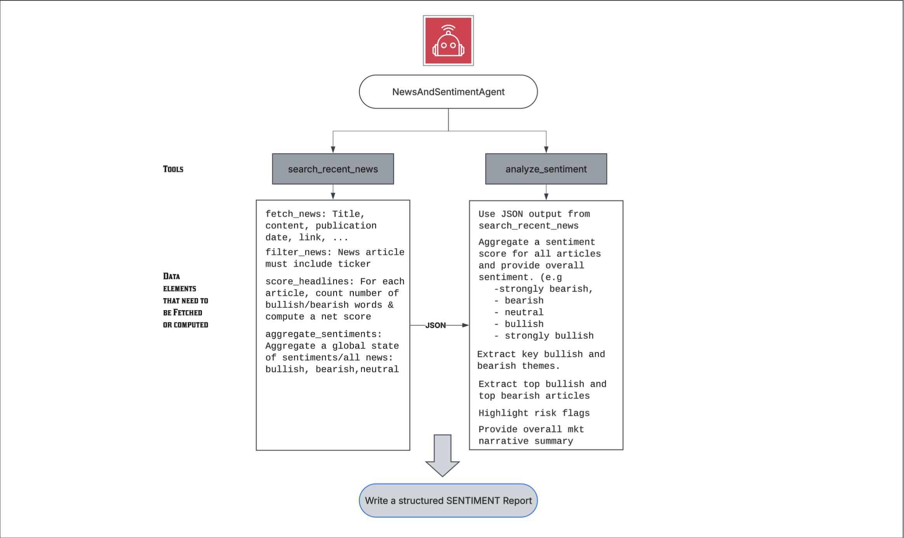
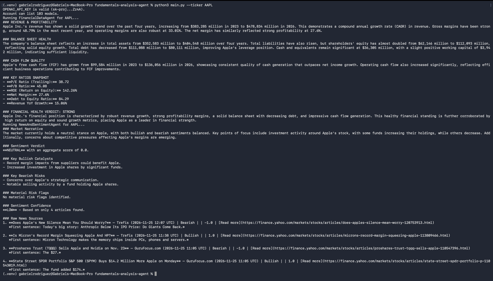
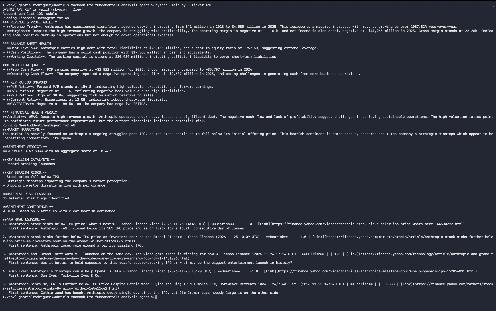
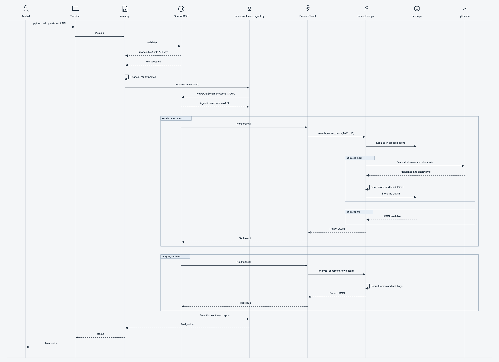

# Contents

### [Building the `NewsAndSentimentAgent`](#)
- [ ] [Environment Setup](#)
- [ ] [Agent Setup](#)
- [ ] [Tool Setup](#)
- [ ] [Agent Create](#)
- [ ] [Unit Testing](#)
- [ ] [Sequence Diagram](#)

----------

# Development

## Building the `NewsAndSentimentAgent`

The `NewsAndSentimentAgent` is a specialized component responsible for retrieving recent news and assessing market sentiment for a given company. 

For a given stock ticker, the `NewsAndSentimentAgent` invokes dedicated tools to collect the latest news articles and compute an aggregate sentiment score. 

The `NewsAndSentimentAgent` produces a structured sentiment report including the market narrative, a five-level scale sentiment verdict, key bullish catalysts, key bearish risks, material risk flags, and a sentiment confidence level. 

<p align=center >
    
</p>

Repeating the same process as was found in the `FinancialDataAgent` we will be once again modifying or building the following 3 code components. 
1. Foundational code for the development *Environment* | framework | directory structure to work. This includes utilities, libraries, folder structure, imports, and `main.py`.
2. Code that creates the *Agent*, found in `specialist_agents/news_and_sentiment_agent.py`. 
3. Code that provides the *Tools* the agent uses, found in `tools/news_tools.py`

<p align="right"><small><a href="#contents">Back to Top</a></small></p>

--------

### Environment Setup

Change to the root directory

```sh
cd fundamentals-analysis-agent
```

Create the virtual environment
```sh
python3 -m venv .venv
source .venv/bin/activate
```

Install the dependencies 
```sh
pip install -r requirements.txt
```

Copy your OpenAPI key. Copy .env.example to .env and add your key: 
```sh
cp .env.example .env
```

Ensure that you have an OpenAPI key from this site: [OpenAI](https://platform.openai.com/api-keys), and paste into the `.env.example` file. Replace the `sk-your-openai-api-key-here` with your actual key.

```python
OPENAI_API_KEY=sk-your-openai-api-key-here
```

Create a file called `main.py` and input the following code, this will verify that you set up your OpenAI API key correctly. 

```python
import sys

from dotenv import load_dotenv
from openai import APIConnectionError, APIStatusError, AuthenticationError, OpenAI


PLACEHOLDER_VALUES = {
    "",
    "sk-your-openai-api-key-here",
}

def main() -> int:
    load_dotenv()

    client = OpenAI()
    key = client.api_key or ""

    if key.strip() in PLACEHOLDER_VALUES:
        print("OPENAI_API_KEY is missing. Copy .env.example to .env and set a real key.")
        return 1

    try:
        page = client.models.list()
        model_ids = [model.id for model in page.data]
    except AuthenticationError:
        print("OPENAI_API_KEY was rejected (401). Check the key on platform.openai.com.")
        return 1
    except APIConnectionError as exc:
        print(f"Could not reach the OpenAI API: {exc}")
        return 1
    except APIStatusError as exc:
        print(f"OpenAI API returned status {exc.status_code}: {exc.message}")
        return 1

    preview = f"{key[:7]}...{key[-4:]}" if len(key) > 12 else "(set)"
    print(f"OPENAI_API_KEY is valid ({preview}).")
    print(f"Account can list {len(model_ids)} models.")
    return 0


if __name__ == "__main__":
    sys.exit(main())
```

> NOTE: The only thing this code does is check to see if your OpenAI key is valid, it does not yet invoke our FinancialDataAgent. That will come later. 

Create a `.gitignore` file so you .env file and the OpenAI key does not get committed to `github`. Input the following code: 

```python
# Virtual environments
.venv/
venv/

# Environment / secrets
.env

# Logs and run artifacts
logs/
working_memory.txt
*.log
```

Create a `tools` and an `specialist_agents` directory so you can input the Agent build scripts and the Tool scripts in thier respective directories and can reference, scale, or troubleshoot them as needed later. 

```sh
# Be sure you are in the `fundamentals-analysis-agent` directory before running the next line
mkdir tools specialist_agents
```

<p align="right"><small><a href="#contents">Back to Top</a></small></p>

----------

### Agent Setup

Start by defining the instructions of the agent which act as its *operating policy*. We will create a file in the `specialist_agents` directory called `news_sentiment_agent.py`. 

In that file, we will start by adding instructions to clearly specify the agent's role. This is similar to a prompt you may enter into a LLM session (e.g. Claude, Co-Pilot, Grok, etc). 

What you are doing is providing instructions that we will pass to the OpenAI LLM via API using a prompting technique called PCIF (Persona, Context, Instructions, & Format) [here](./reference/pcif.md). Here we will consistently defining for the Agent we are about to create how to behave like a senior financial analyst specialized  in interpretting corporte financial statements. They also define the exact workflow the agent must follow by explicitly listing the tool calls in sequence and explaining the purpose of each one. 

```python
# file -> fundamentals-analysis-agent/specialist_agents/news-sentiment-agent.py

"""
news_sentiment_agent.py
-----------------------
Specialist agent for news retrieval and market sentiment scoring.

This agent fetches recent news for a stock and produces a structured
sentiment assessment: an aggregate score, key market narratives, and
any risk flags (regulatory issues, fraud, lawsuits) that warrant attention.

The sentiment output complements quantitative data with qualitative,
forward-looking market signals.
"""

# PLACEHOLDER 1 IMPORTS: We will insert more code here to Import tools (see Tool Setup below)

NEWS_SENTIMENT_INSTRUCTIONS = """
You are a market intelligence analyst specializing in news analysis
and investor sentiment for publicly traded companies.

Your job:
Retrieve and analyze recent news for a stock ticker to surface the current
market narrative, sentiment, and any material risk events.

Steps to follow:

1. CALL search_recent_news(ticker, max_results=15)
   This fetches the latest headlines with preliminary sentiment labels.

2. CALL analyze_sentiment(news_json) with the JSON output from step 1.
   This produces an aggregate sentiment score and key themes.

3. WRITE A STRUCTURED SENTIMENT REPORT with these sections:

   - MARKET NARRATIVE: In 2-3 sentences, what is the dominant story the market
     is telling about this company right now? (e.g., "The market is focused on
     Apple's AI integration, strong services revenue, and upcoming product cycle.")

   - SENTIMENT VERDICT: [STRONGLY BULLISH | BULLISH | NEUTRAL |
     BEARISH | STRONGLY BEARISH] with the aggregate score.

   - KEY BULLISH CATALYSTS: Bullet list of positive themes from headlines.
     (e.g., earnings beat, new product launch, analyst upgrades, buybacks)

   - KEY BEARISH RISKS: Bullet list of negative themes.
     (e.g., regulatory concerns, margin pressure, competitive threats)

   - MATERIAL RISK FLAGS: Any headlines involving lawsuits, investigations,
     fraud, recalls, or regulatory actions. These are high-priority.
     If none, state "No material risk flags identified."

   - SENTIMENT CONFIDENCE: [HIGH | MEDIUM | LOW] based on the volume
     and recency of news. Low if fewer than 5 articles found.

   - RAW NEWS SOURCES: List every article from all_articles in the sentiment
     result as a numbered list with this format for each entry:
     [N] <title> — <publisher> (<published_at>) | <sentiment> | | <score> | <url>
         First sentence: <first_sentence>  (omit this line if first_sentence is null)
     This section is mandatory. It allows readers to verify the analysis
     against the original sources.

Focus on substance, not noise. One major regulatory investigation matters more
than ten generic "stock rises" headlines.
"""

# PLACEHOLDER 2 Agent CREATE: We will insert more code here to create the Agent (see Agent Create below)

```

<p align="right"><small><a href="#contents">Back to Top</a></small></p>

---------

### Tool Setup

Agents use tools to execute the functions that we specify through code, these are *Tools* we provision the agent to execute a task. Sometimes these tools can be a request to an MCP service, and API, or functions that we write in code. 

The *Tools* that we require for our `NewsAndSentimentAgent` are:
1. `search_recent_news` 
2. `analyzez_sentiment` 

We will not write the logic for these tools directly in our `news-sentiment-agent.md` file, because tools are different than an Agent. We may add tools without ever modifying our Agent for example, so we want to keep a separation of concerns rule in our directory/file archtiecture. 

Therefore, in our `fundamentals-analysis-agent/tools` directory, we need to create another file called `news_tools.py`. 

In this file input the following code: 

```python
"""
news_tools.py
-------------
Tools for fetching recent news and scoring market sentiment for a given ticker.
Uses yfinance for free news retrieval with no API key required.
"""

import json
import re
from datetime import datetime, timezone
import yfinance as yf
from agents import function_tool
from tools import cache as _cache


# ---------------------------------------------------------------------------
# Sentiment lexicon — simple but effective for financial news
# ---------------------------------------------------------------------------

# ---------------------------------------------------------------------------
# Schema validation
# ---------------------------------------------------------------------------

# ---------------------------------------------------------------------------
# Tool 1: Search Recent News
# ---------------------------------------------------------------------------

# ---------------------------------------------------------------------------
# Tool 2: Analyze Sentiment
# ---------------------------------------------------------------------------
```

Here you can see that we've once again allowed ourselves a method to import other helper utilities, libraries, and make reference to other files we will use. I've also used comments to draft psuedo-code areas of functionality/logic we will have to write to implement the logic we want to define for our Agent to execute. The file will get too large to write an explanation for all the code, so if you want to see the Python code that gets executed for each of these areas, review the file `fundamentals-analysis-agent/tools/news_tools.py`. 

A small example would look like this: 

```python
# ---------------------------------------------------------------------------
# Sentiment lexicon — simple but effective for financial news
# ---------------------------------------------------------------------------

BULLISH_SIGNALS = [
    "beat", "beats", "surpass", "record", "growth", "profit", "revenue",
    "upgrade", "buy", "outperform", "strong", "rally", "surge", "rises",
    "gains", "positive", "innovative", "launch", "partnership", "expansion",
    "dividend", "buyback", "raised", "exceeds", "momentum", "bullish",
    "breakthrough", "wins", "awarded", "approved", "acquisition",
]

BEARISH_SIGNALS = [
    "miss", "misses", "decline", "loss", "cut", "downgrade", "sell",
    "underperform", "weak", "fall", "drop", "concern", "warning", "risk",
    "lawsuit", "investigation", "fraud", "scandal", "layoffs", "recall",
    "fine", "penalty", "below", "disappoints", "slump", "crash", "bearish",
    "negative", "headwind", "uncertainty", "regulatory", "antitrust",
]


def _score_headline(headline: str) -> tuple[str, float]:
    """
    Score a single headline as bullish/bearish/neutral.
    Returns (label, score) where score is 0-1 for bullish, -1 to 0 for bearish.
    """
    text = headline.lower()
    bull_count = sum(1 for word in BULLISH_SIGNALS if word in text)
    bear_count = sum(1 for word in BEARISH_SIGNALS if word in text)

    total = bull_count + bear_count
    if total == 0:
        return "neutral", 0.0

    net_score = (bull_count - bear_count) / total
    if net_score > 0.15:
        label = "bullish"
    elif net_score < -0.15:
        label = "bearish"
    else:
        label = "neutral"

    return label, round(net_score, 3)
``` 

> Here you see the Sentiment Lexicon that the Agent will use to assess articles and determine a basis for bullish or bearish sentiment towards the ticker symbol. Similar python logic is written for Tool 1: Search Recent News, Tool 2: Analyze Sentiment, Schema Validation, etc. Each block of code returns a JSON formatted output that the LLM can evaluate from a cache or from the yFinance source directly. The code ensures that the agent has a consistent set of input to apply inference, as the payload it receives from the tool output is consistently providing the information the prompt needs. 

These `tools` will need to be imported into our `news-sentiment-agent.py` file, which was the Placeholder 1 reference above. Go back to the `fundamentals-analysis-agent/news-sentiment-agent.py` file and insert the following code now that the `fundamentals-analysis-agent/news-tools.py` file is creaetd. 

```python
# PLACEHOLDER 1 IMPORTS: We will insert more code here to Import tools (see Tool Setup below)
from agents import Agent
from tools.news_tools import (
    search_recent_news,
    analyze_sentiment,
)
```

<p align="right"><small><a href="#contents">Back to Top</a></small></p>

---------

### Agent Create

Now we can use the OpenAI Agent class to create a new Agent and pass the tools we've just created to the Agent. Go back to the `fundamentals-analysis-agent/news-sentiment-agent.py` file and insert the following code at the *Placeholder 2 Agent Create* location. 

```python
# ...

# PLACEHOLDER 2 Agent CREATE: We will insert more code here to create the Agent (see Agent Create below)
news_sentiment_agent = Agent(
    name="NewsAndSentimentAgent",
    instructions=NEWS_SENTIMENT_INSTRUCTIONS,
    tools=[
        search_recent_news,
        analyze_sentiment,
    ],
    model="gpt-4o",
)
```

> Here from the `openai` import, we are able to use the OpenAI class `Agent` and assign it a name `NewsAndSentimentAgent`. We are also able to pass, at Agent creation, a name, instructions, and tools, and the model instance that we want the Agent to use. Documentation on using the OpenAI spec is [here](https://developers.openai.com/api/docs/guides/agents/quickstart)

<p align="right"><small><a href="#contents">Back to Top</a></small></p>

--------

### Summary

What we've done:
1. We've used the same pattern to construct the 2nd of 2 agents in our multi-agent solution (MAS). 
2. While the logic that executes during the tool call is different the same pattern for tool consumption by the Agent has been demonstrated again. 

What this enables: 
1. Our `fundamentals-analysis` problem set now has 2 of 5 Agents, the `FinancialDataAgent` that can retrieve four types of financial information, is now augmented with the `NewsAndSentimentAgent`. 

2. The instructions provided enable the agent to produce a structured sentiment report that captures the current market narrative, an overall sentiment verdict (STRONGLY BULLISH, BULLISH, NEUTRAL, BEARISH, and STRONGLY BEARISH), and key bullish and bearish themes emerging from recent headlines. It also highlights material risk flags, such as regulatory actions, lawsuits, or investigations, that may have a significant impact on the company's outlook. In addition, to ensure transparency and auditability, the agent includes a detailed list of raw news sources, enabling verification of the analysis. 

3. A key design element is the emphasis on signal over noise. The agent is encouraged to prioritize meaningful events, such as regulatory actions or major announcements, rather than overreacting to repetitivve or low-impact headlines.

<p align="right"><small><a href="#contents">Back to Top</a></small></p>

----------

### Unit Testing 

Now that we have 2 of 5 agents, lets test to see if it is actually executing calls to its tooling suite and producing a repeatable outcome with our intende objectives. Before we can test the 1. *Environment Setup* 2. The *Agent* & 3. The *Tooling* we need to write some code in the `main.py` file. 

Recall the `main.py` file is presently set up to validate our python version, verify our API key, and execute our `FinancialDataAgent`. We need to add a call to the `NewsAndSentimentAgent` and pass the same ticker symbol so the analysis can be completed. 

The `main.py` file needs to add a function to execute the news and sentiment agent. Create this function as follows: 

```python
def run_news_sentiment(ticker: str) -> str:
    """Run NewsAndSentimentAgent for a ticker and return its structured report.

    The agent fetches recent headlines, scores sentiment, and writes the
    report defined in its instructions.
    """
    symbol = ticker.strip().upper()
    if not symbol:
        raise ValueError("A ticker symbol is required, for example AAPL.")

    from agents import Runner
    from agents.exceptions import AgentsException

    from specialist_agents.news_sentiment_agent import news_sentiment_agent

    load_dotenv()
    result = Runner.run_sync(
        news_sentiment_agent,
        (
            f"Analyze recent news and investor sentiment for {symbol}. "
            "Follow your required tool sequence and return the structured sentiment report."
        ),
    )
    if not result.final_output:
        raise AgentsException(f"NewsAndSentimentAgent returned no report for {symbol}.")
    return str(result.final_output)
```

We need to refactor the main function that orchestrates the applicatoin. Update the `main.py` file as follows: 

```python
def main(argv: list[str] | None = None) -> int:
    parser = argparse.ArgumentParser(
        description=(
            "Check the OpenAI API key, or run the financial and news sentiment "
            "agents for a ticker."
        ),
    )
    parser.add_argument(
        "--ticker",
        help="Stock ticker to analyze, for example AAPL. Omit to only check the API key.",
    )
    args = parser.parse_args(argv)

    if args.ticker is not None and sys.version_info < (3, 10):
        current = sys.version.split()[0]
        print(
            "The analysis agents require Python 3.10 or newer "
            f"(this interpreter is {current})."
        )
        print("Recreate the virtual environment with a newer Python:")
        print("  /opt/homebrew/bin/python3 -m venv .venv")
        print("  source .venv/bin/activate")
        print("  pip install -r requirements.txt")
        return 1

    status = check_api_key()
    if args.ticker is None or status != 0:
        return status

    from agents.exceptions import AgentsException

    symbol = args.ticker.strip().upper()
    agent_errors = (
        ValueError,
        AgentsException,
        AuthenticationError,
        APIConnectionError,
        APIStatusError,
    )
    failed = False

    print(f"Running FinancialDataAgent for {symbol}...")
    try:
        print(run_financial_analysis(symbol))
    except agent_errors as exc:
        print(f"Financial analysis failed: {exc}")
        failed = True

    print(f"Running NewsAndSentimentAgent for {symbol}...")
    try:
        print(run_news_sentiment(symbol))
    except agent_errors as exc:
        print(f"News and sentiment analysis failed: {exc}")
        failed = True

    return 1 if failed else 0
```


#### Explanation
> `argparse` accepts one optional flag, --ticker. Omit it and the program only checks the key. Pass a symbol, such as AAPL, and it also runs the analysis. argv defaults to None, so a normal command line is used. Tests can pass a list instead, for example main(["--ticker", "AAPL"]). 

#### Python version gate
> The Agents SDK and the tool code need Python 3.10 or newer. That check runs only when a ticker was provided, and it runs before any API call. On an older interpreter it prints the version and the commands to rebuild .venv, then exits with 1. A plain python main.py still performs the key check on older Python. 

#### Key check
> Will execute a stop or continue. `check_api_key()` loads .env and confirms the key with OpenAI. It returns 0 or 1. The next condition exits in two cases:
> 1. No ticker was passed, so the key check was the whole job. Its status becomes the program’s exit code.
> 2. A ticker was passed, but the key check failed. The agent is not started.

#### Run the agent(s)
> With a valid key and a ticker, it imports `AgentsException` and calls `run_financial_analysis`. It now also passes the ticker symbol to the `run_news_sentiment` function which initiates the `NewsAndSentiment` agent. The ticker is printed in uppercase so aapl shows up as AAPL.

#### Failure Handling
> Failures stay as an exit code. These are caught and printed, then the function returns 1:
> 1. ValueError — Is a Python built-in Exception that executes if the ticker string is empty
> 2. AgentsException — Comes from the OpenAI Agents SDK package, it returns if the agent run fails, or it returns no analysis
> 3. AuthenticationError, APIConnectionError, APIStatusError — These come from the `openai` Python package we imported and return if the the OpenAI call is rejected, unreachable, or returns an error status

With this code in place lets try a ticker symbol and lets see what we get. In a terminal session ensure you are in the `fundamentals-analysis-agent` directory and run the following command: 

```sh
python3 main.py --ticker AAPL
```

<p align=center >
    
</p>

See if the consistency is valid by entering a new ticker symbol, say Anthropic which is *ANT*: 

```sh
python3 main.py --ticker ANT
```

<p align=center >
    
</p>

*Explanation*
It follows the same path as the financial data agent from the terminal command, the API-key check, then the agent run. Because python main.py --ticker AAPL prints the financial report first, that step is the self-call on main.py labeled "Financial report printed." After that, run_news_sentiment() starts the news agent.

The two tool calls are separate, because they do not do the same work:

`search_recent_news` looks in `cache.py`. On a miss it reads `stock.news` and `stock.info` from yfinance, keeps articles about the company, scores the headlines, and stores the JSON. 

On a hit it returns the stored JSON. `analyze_sentiment` stays inside `news_tools.py`. It turns that JSON into the aggregate score, themes, and risk flags. It does not call the cache or yfinance.

<p align="right"><small><a href="#contents">Back to Top</a></small></p>

----------

### Sequence Diagram

A visual depcition of what is going on looks like this: 

#### `NewsAndSentimentAgent` Sequence Flow

<p align=center >
    
</p>


<p align="right"><small><a href="#contents">Back to Top</a></small></p>

----------