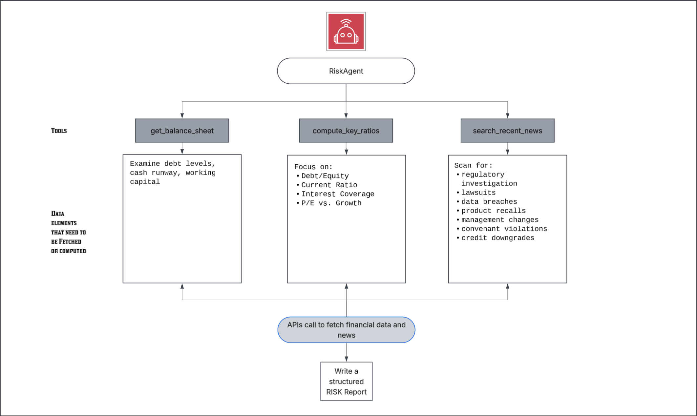
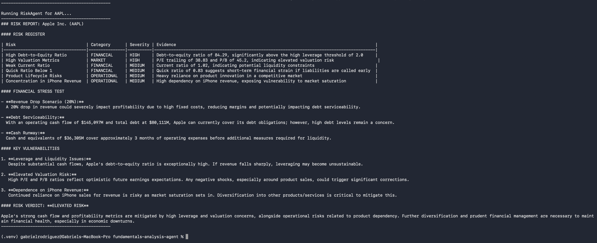
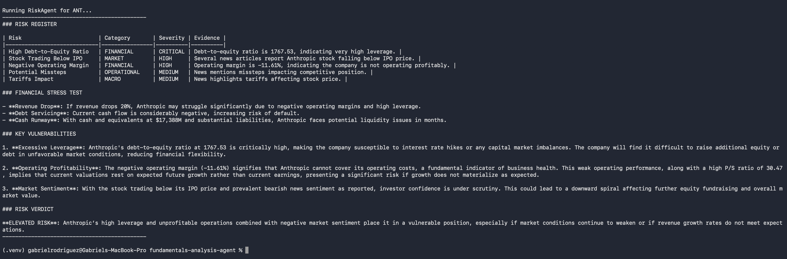
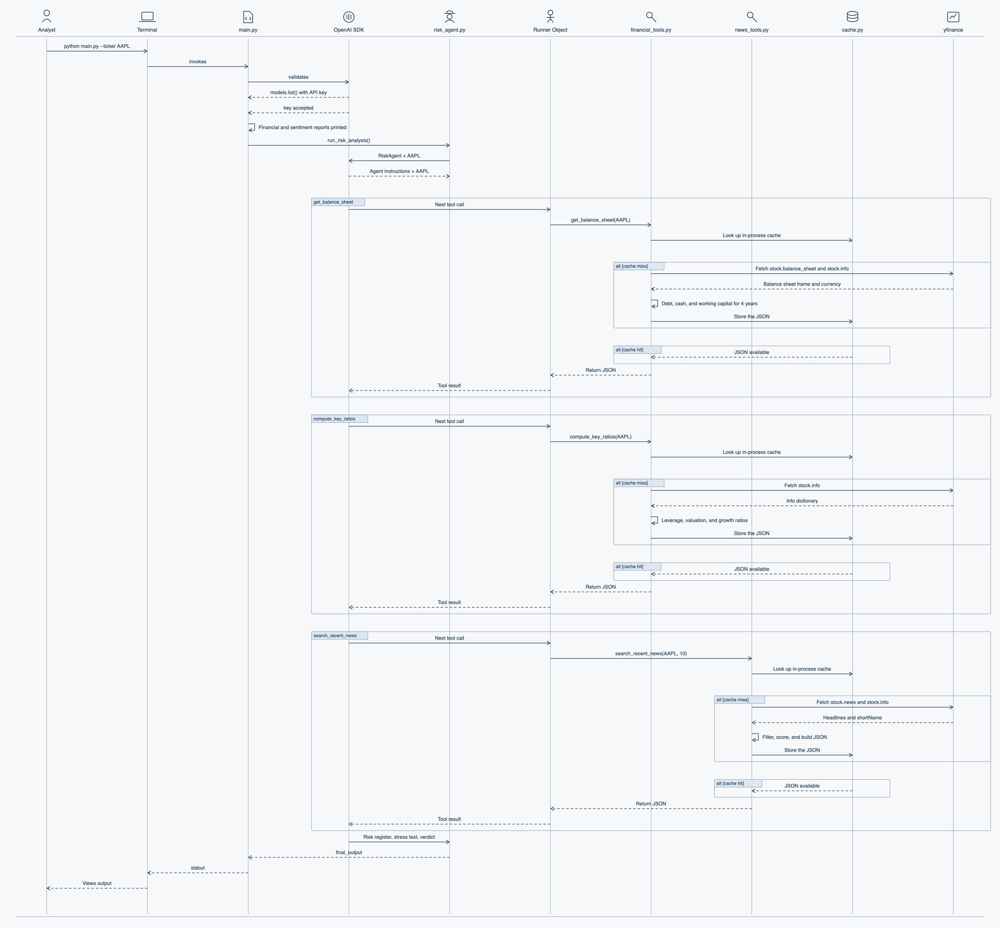

# Contents

### [Building the `NewsAndSentimentAgent`](#)
- [ ] [Environment Setup](#)
- [ ] [Agent Setup](#)
- [ ] [Tool Setup](#)
- [ ] [Agent Create](#)
- [ ] [Unit Testing](#)
- [ ] [Sequence Diagram](#)

----------

# Development

## Building the `RiskAgent`

The `RiskAgent` is a specialized, component dedicate to identifying and assesing the potential risks associated with an investment. Its role is to challenge optimistic assumptions by systematically uncovering vulnerabilities in the company's financial position and operating environment. 


<p align=center >
    
</p>

Repeating the same process as was found in the `FinancialDataAgent`, & the `NewsAndSentimentAgent` we will be once again modifying or building the following 3 code components. 
1. Foundational code for the development *Environment* | framework | directory structure to work. This includes utilities, libraries, folder structure, imports, and `main.py`.
2. Code that creates the *Agent*, found in `specialist_agents/news_and_sentiment_agent.py`. 
3. Code that provides the *Tools* the agent uses, found in `tools/news_tools.py`

<p align="right"><small><a href="#contents">Back to Top</a></small></p>

--------

### Environment Setup

There is no new Environment setup needed for the `RiskAgent`. The setup completed when we built the `FinancialDataAgent` is still sufficient. Refer to that section if any questions on how the setup and the `main.py` file were initiated. 

<p align="right"><small><a href="#contents">Back to Top</a></small></p>

----------

### Agent Setup

Start by defining the instructions of the agent which act as its *operating policy*. We will create a file in the `specialist_agents` directory called `risk-agent.py`. 

In that file, we will start by adding instructions to clearly specify the agent's role. This is similar to a prompt you may enter into a LLM session (e.g. Claude, Co-Pilot, Grok, etc). 

What you are doing is providing instructions that we will pass to the OpenAI LLM via API using a prompting technique called PCIF (Persona, Context, Instructions, & Format) [here](./reference/pcif.md). Here we will consistently defining for the Agent we are about to create how to behave like a senior financial analyst specialized  in interpretting corporte financial statements. They also define the exact workflow the agent must follow by explicitly listing the tool calls in sequence and explaining the purpose of each one. 

```python
# file -> fundamentals-analysis-agent/specialist_agents/risk-agent.py

"""
risk_agent.py
-------------
Specialist agent for investment risk assessment.

This agent acts as a "devil's advocate" — its sole purpose is to identify
what could go wrong with an investment. It examines balance sheet stress
points, leverage, liquidity risks, and qualitative risk factors.

It uses the financial tools to compute risk metrics and then synthesizes
them into a structured risk report with a severity rating per risk.
"""

# PLACEHOLDER 1 IMPORTS: We will insert more code here to Import tools (see Tool Setup below)

RISK_INSTRUCTIONS = """
You are a risk analyst at a hedge fund. Your job is to stress-test investment
theses and find the vulnerabilities that optimistic analysts overlook.

You are deliberately skeptical. Your goal is NOT to be bearish for its own sake,
but to identify REAL, MATERIAL risks that an investor must weigh.

Steps to follow:

1. CALL get_balance_sheet(ticker) — examine debt levels, cash runway,
   working capital. A company burning cash with high debt is a red flag.

2. CALL compute_key_ratios(ticker) — focus on:
   - Debt/Equity: >2.0 is high leverage territory
   - Current Ratio: <1.0 means current liabilities exceed current assets
   - Interest Coverage: implied from operating income / interest expense
   - P/E vs growth: if P/E is high but growth is slowing, valuation risk is elevated

3. CALL search_recent_news(ticker, max_results=10) — scan for:
   regulatory investigations, lawsuits, data breaches, product recalls,
   management changes, covenant violations, credit downgrades.

4. WRITE A STRUCTURED RISK REPORT:

   RISK REGISTER (table format):
   For each risk identified, provide:
   | Risk | Category | Severity | Evidence |
   Categories: [FINANCIAL | OPERATIONAL | REGULATORY | MARKET | MACRO]
   Severity: [LOW | MEDIUM | HIGH | CRITICAL]

   FINANCIAL STRESS TEST:
   - What happens to the company if revenue drops 20%?
   - Can it service its debt with current cash flow?
   - What is the cash runway (months of expenses covered by cash)?

   KEY VULNERABILITIES:
   Top 3 specific risks with detailed explanation.

   RISK VERDICT: One of:
   [LOW RISK | MODERATE RISK | ELEVATED RISK | HIGH RISK]
   with a 2-sentence justification.

Be specific and evidence-based. Vague risks like "macroeconomic uncertainty"
only add value if you connect them to specific company vulnerabilities.
"""

# PLACEHOLDER 2 Agent CREATE: We will insert more code here to create the Agent (see Agent Create below)

```

<p align="right"><small><a href="#contents">Back to Top</a></small></p>

---------

### Tool Setup

Agents use tools to execute the functions that we specify through code, these are *Tools* we provision the agent to execute a task. Sometimes these tools can be a request to an MCP service, and API, or functions that we write in code. 

The *Tools* that we require for our `RiskAgent` are:
1. `get_balance_sheet` 
2. `compute_key_ratios`
3. `search_recent_news` 

These tools should look familiar. The tools needed by the `RiskAgent` are already available in the `tool chest` that was created in the `tools` directory. 

Two of the tools were created with the 
- `FinancialDataAgent`
    - `get_balance_sheet`
    - `compute_key_ratios`

And 
- `NewsAndSentimentAgent` created the
    - `search_recent_news` 

This once again demonstrates a scalable pattern that maximizes sharing and reuse. Tools built in a structure like the one provided can be shared. Each Agent created does not need to come with its own tooling, they can be entered into a directory structure where the tool inventory can scale, while the Agent inventory stays static. Or, in this case, the Agent quantity can scale while the tool inventory stays static. This is an intended outcome of constructing the `directory architecture` in this manner and should be repeated or improved upon. 

Therefore, there are no tools to be written for this agent and no file added in this case to the `tools` directory. 

These `tools` will need to be imported into our `news-sentiment-agent.py` file, which was the Placeholder 1 reference above. Go back to the `fundamentals-analysis-agent/news-sentiment-agent.py` file and insert the following code now that the `fundamentals-analysis-agent/news-tools.py` file is creaetd. 

Because new tools were not created, and we are reusing tools the import statement will need to be adjusted accordingly. Note the reference to the `financial_tools.py` file, the suffix `.py` does not need to be added due to syntax. 

```python
# PLACEHOLDER 1 IMPORTS: We will insert more code here to Import tools (see Tool Setup below)
from agents import Agent
from tools.financial_tools import (
    get_balance_sheet,
    compute_key_ratios,
)
from tools.news_tools import search_recent_news
```

<p align="right"><small><a href="#contents">Back to Top</a></small></p>

---------

### Agent Create

Now we can use the OpenAI Agent class to create a new Agent and pass the tools we've just created to the Agent. Go back to the `fundamentals-analysis-agent/risk-agent.py` file and insert the following code at the *Placeholder 2 Agent Create* location. 

```python
# ...

# PLACEHOLDER 2 Agent CREATE: We will insert more code here to create the Agent (see Agent Create below)
risk_agent = Agent(
    name="RiskAgent",
    instructions=RISK_INSTRUCTIONS,
    tools=[
        get_balance_sheet,
        compute_key_ratios,
        search_recent_news,
    ],
    model="gpt-4o",
)
```

> Here from the `openai` import, we are able to use the OpenAI class `Agent` and assign it a name `RiskAgent`. We are also able to pass, at Agent creation, a name, instructions, and tools, and the model instance that we want the Agent to use. Documentation on using the OpenAI spec is [here](https://developers.openai.com/api/docs/guides/agents/quickstart)

<p align="right"><small><a href="#contents">Back to Top</a></small></p>

--------

### Summary

What we've done:
1. We've used the same pattern to construct the 2nd of 2 agents in our multi-agent solution (MAS). 
2. We've demonstrated that tooling can be reused, both accelerating the agent development, and providing a mechanism for Agents to scale independent of Tools. 

What this enables: 
1. Our `fundamentals-analysis` problem set now has 3 of 5 Agents, the `FinancialDataAgent` that can retrieve four types of financial information, is now augmented with the `NewsAndSentimentAgent`, and now we have an independent agent with a purposely "realistic/pessimistic" view of the information provide that serves as our "Risk Advisor". 

2. The instructions provided enable the agent to produce a structured sentiment report that captures the current market narrative, an overall sentiment verdict (STRONGLY BULLISH, BULLISH, NEUTRAL, BEARISH, and STRONGLY BEARISH), and key bullish and bearish themes emerging from recent headlines. It also highlights material risk flags, such as regulatory actions, lawsuits, or investigations, that may have a significant impact on the company's outlook. In addition, to ensure transparency and auditability, the agent includes a detailed list of raw news sources, enabling verification of the analysis. 

3. A key design element is the emphasis on signal over noise. The agent is encouraged to prioritize meaningful events, such as regulatory actions or major announcements, rather than overreacting to repetitivve or low-impact headlines.

<p align="right"><small><a href="#contents">Back to Top</a></small></p>

----------

### Unit Testing 

Now that we have 3 of 5 agents, lets test to see if it is actually executing calls to its tooling suite and producing a repeatable outcome with our intended objectives. Before we can test the 1. *Environment Setup* 2. The *Agent* & 3. The *Tooling* we need to write some code in the `main.py` file. 

Recall the `main.py` file is presently set up to validate our python version, verify our API key, and execute our `FinancialDataAgent`. We need to add a call to the `NewsAndSentimentAgent` and pass the same ticker symbol so the analysis can be completed. 

The `main.py` file needs to add a function to execute the Risk agent. Create this function as follows: 

```python
def run_risk_analysis(ticker: str) -> str:
    """Run RiskAgent for a ticker and return its structured risk report.

    The agent reviews the balance sheet, key ratios, and recent news, then
    writes the risk register and verdict defined in its instructions.
    """
    symbol = ticker.strip().upper()
    if not symbol:
        raise ValueError("A ticker symbol is required, for example AAPL.")

    from agents import Runner
    from agents.exceptions import AgentsException

    from specialist_agents.risk_agent import risk_agent

    load_dotenv()
    result = Runner.run_sync(
        risk_agent,
        (
            f"Stress-test an investment in {symbol} and identify its material risks. "
            "Follow your required tool sequence and return the structured risk report."
        ),
    )
    if not result.final_output:
        raise AgentsException(f"RiskAgent returned no report for {symbol}.")
    return str(result.final_output)
```

We need to refactor the main function that orchestrates the applicatoin. Update the `main.py` file as follows: 

```python
def main(argv: list[str] | None = None) -> int:
    parser = argparse.ArgumentParser(
        description=(
            "Check the OpenAI API key, or run the financial, news sentiment, "
            "and risk agents for a ticker."
        ),
    )
    parser.add_argument(
        "--ticker",
        help="Stock ticker to analyze, for example AAPL. Omit to only check the API key.",
    )
    args = parser.parse_args(argv)

    if args.ticker is not None and sys.version_info < (3, 10):
        current = sys.version.split()[0]
        print(
            "The analysis agents require Python 3.10 or newer "
            f"(this interpreter is {current})."
        )
        print("Recreate the virtual environment with a newer Python:")
        print("  /opt/homebrew/bin/python3 -m venv .venv")
        print("  source .venv/bin/activate")
        print("  pip install -r requirements.txt")
        return 1

    status = check_api_key()
    if args.ticker is None or status != 0:
        return status

    from agents.exceptions import AgentsException

    symbol = args.ticker.strip().upper()
    agent_errors = (
        ValueError,
        AgentsException,
        AuthenticationError,
        APIConnectionError,
        APIStatusError,
    )
    failed = False

    print(f"Running FinancialDataAgent for {symbol}...")
    try:
        print(run_financial_analysis(symbol))
        print("---------------------------------------------\n")
    except agent_errors as exc:
        print(f"Financial analysis failed: {exc}")
        failed = True

    print(f"Running NewsAndSentimentAgent for {symbol}...")
    try:
        print(run_news_sentiment(symbol))
        print("---------------------------------------------\n")
    except agent_errors as exc:
        print(f"News and sentiment analysis failed: {exc}")
        failed = True

    print(f"Running RiskAgent for {symbol}...")
    try:
        print(run_risk_analysis(symbol))
        print("---------------------------------------------\n")
    except agent_errors as exc:
        print(f"Risk analysis failed: {exc}")
        failed = True

    return 1 if failed else 0

if __name__ == "__main__":
    sys.exit(main())
```

#### Explanation
> `argparse` accepts one optional flag, --ticker. Omit it and the program only checks the key. Pass a symbol, such as AAPL, and it also runs the analysis. argv defaults to None, so a normal command line is used. Tests can pass a list instead, for example main(["--ticker", "AAPL"]). 

#### Python version gate
> The Agents SDK and the tool code need Python 3.10 or newer. That check runs only when a ticker was provided, and it runs before any API call. On an older interpreter it prints the version and the commands to rebuild .venv, then exits with 1. A plain python main.py still performs the key check on older Python. 

#### Key check
> Will execute a stop or continue. `check_api_key()` loads .env and confirms the key with OpenAI. It returns 0 or 1. The next condition exits in two cases:
> 1. No ticker was passed, so the key check was the whole job. Its status becomes the program’s exit code.
> 2. A ticker was passed, but the key check failed. The agent is not started.

#### Run the agent(s)
> With a valid key and a ticker, it imports `AgentsException` and calls `run_financial_analysis`. It now also passes the ticker symbol to the `run_news_sentiment` function which initiates the `NewsAndSentiment` agent. The ticker is printed in uppercase so aapl shows up as AAPL.

#### Failure Handling
> Failures stay as an exit code. These are caught and printed, then the function returns 1:
> 1. ValueError — Is a Python built-in Exception that executes if the ticker string is empty
> 2. AgentsException — Comes from the OpenAI Agents SDK package, it returns if the agent run fails, or it returns no analysis
> 3. AuthenticationError, APIConnectionError, APIStatusError — These come from the `openai` Python package we imported and return if the the OpenAI call is rejected, unreachable, or returns an error status

With this code in place lets try a ticker symbol and lets see what we get. In a terminal session ensure you are in the `fundamentals-analysis-agent` directory and run the following command: 

```sh
python3 main.py --ticker AAPL
```

<p align=center >
    
</p>

See if the consistency is valid by entering a new ticker symbol, say Anthropic which is *ANT*: 

```sh
python3 main.py --ticker ANT
```

<p align=center >
    
</p>

*Explanation*
It follows the same path as the financial data agent from the terminal command, the API-key check, then the agent run. Because python main.py --ticker AAPL prints the financial report first, that step is the self-call on main.py labeled "Financial report printed." After that, run_news_sentiment() starts the news agent.

The two tool calls are separate, because they do not do the same work:

`search_recent_news` looks in `cache.py`. On a miss it reads `stock.news` and `stock.info` from yfinance, keeps articles about the company, scores the headlines, and stores the JSON. 

On a hit it returns the stored JSON. `analyze_sentiment` stays inside `news_tools.py`. It turns that JSON into the aggregate score, themes, and risk flags. It does not call the cache or yfinance.

<p align="right"><small><a href="#contents">Back to Top</a></small></p>

----------

### Sequence Diagram

A visual depcition of what is going on looks like this: 

#### `RiskAgent` Sequence Flow

<p align=center >
    
</p>


<p align="right"><small><a href="#contents">Back to Top</a></small></p>

----------